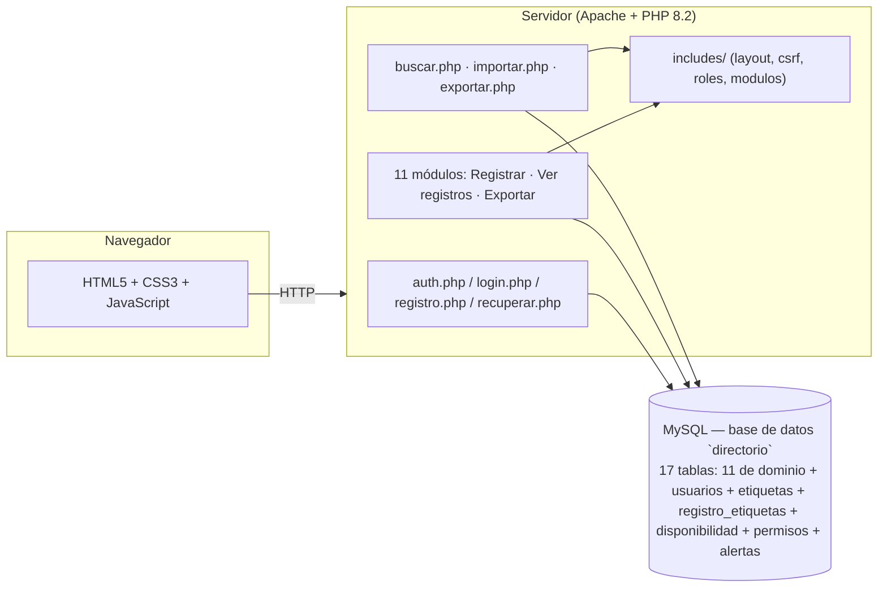
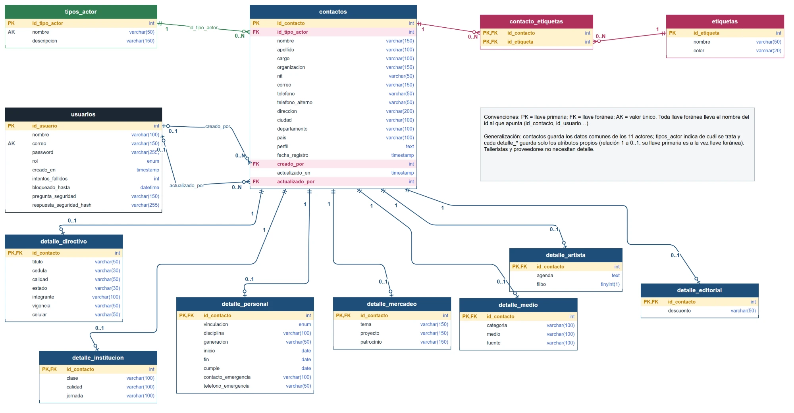

# SIRAD — Sistema de Registro y Administración de Directorios

Aplicación web para centralizar el directorio institucional de la **Fundación Rafael Pombo**: once módulos (instituciones educativas, practicantes, artistas, talleristas, editoriales, asocajas, mercadeo, proveedores, medios, team y directivos), con registro, edición, consulta, eliminación, búsqueda global, importación masiva y exportación a Excel.

Proyecto de grado (Ingeniería de Sistemas, UNIMINUTO). Uso restringido al contexto académico y de la Fundación — no tiene licencia de código abierto.

## Funcionalidades

- **Autenticación**: registro e inicio de sesión con contraseñas encriptadas (`password_hash`), bloqueo temporal tras 5 intentos fallidos, y recuperación de contraseña mediante pregunta de seguridad.
- **Registro con aprobación**: el registro es una *solicitud*. Las cuentas nuevas quedan **pendientes** y no pueden iniciar sesión hasta que un administrador las apruebe en `usuarios.php` (o las rechace). El primer usuario registrado queda como administrador y aprobado. Si el administrador revoca una cuenta, su sesión abierta se cierra en la siguiente petición.
- **Política de tratamiento de datos** (`politica.php`): para crear la cuenta hay que aceptarla; se guardan la versión y la fecha de aceptación (`politica_version`, `politica_aceptada_en`). La versión vigente está en `includes/politica.php`. El texto es un borrador que la Fundación debe revisar y completar con sus datos de contacto.
- **Roles y permisos por módulo**: el primer usuario registrado queda como **administrador** automáticamente; el resto se crea como **usuario**. Editar, eliminar y exportar a Excel están restringidos a administradores. Un usuario aprobado **no ve ni registra nada** hasta que un administrador le asigne, en `usuario_editar.php`, los permisos de cada módulo: **Ver** (consultar los registros) y **Registrar** (agregar registros nuevos). Sin permisos, el panel no muestra módulos y se bloquean la búsqueda, la importación y las plantillas; los cambios de permisos rigen de inmediato, incluso en sesiones abiertas.
- **Alertas para el administrador** (`alertas.php`): el encabezado muestra cuántas alertas hay sin leer. Se registran las cuentas nuevas (con aviso para aprobarlas), los inicios de sesión de usuarios y los intentos de entrar con una cuenta aún no aprobada; se pueden marcar como leídas.
- **CRUD por módulo**: cada uno de los once módulos tiene su propio formulario de registro/edición y su vista de consulta, con búsqueda y paginación del lado del cliente.
- **Búsqueda global** (`buscar.php`): busca un término en los once módulos a la vez.
- **Importación masiva** (`importar.php`): carga registros desde un CSV, con plantilla descargable por módulo y detección de correos duplicados. La pueden usar los administradores y los usuarios a quienes un administrador les asigne el permiso de importación (columna `puede_importar`, desde `usuarios.php` o `usuario_editar.php`); además, un usuario solo importa a los módulos donde tiene permiso de **Registrar**.
- **Agenda de disponibilidad** (Artistas y Talleristas): cada registro puede tener varios horarios con día, hora de inicio y fin, tipo (disponible u ocupado) y nota. Se guardan en una sola tabla compartida, `disponibilidad` (`modulo` + `registro_id`, igual que `registro_etiquetas`), y no como un campo repetido en cada módulo. Los horarios de un mismo día no pueden cruzarse. El campo de texto `agenda` de Artistas se conserva como «Agenda (notas)».
- **Exportación a Excel** (`exportar.php`): descarga los registros de un módulo filtrados por rango de fechas.
- **Etiquetas** (`etiquetas.php`): quien tiene permiso de **Registrar** en un módulo clasifica sus registros con etiquetas de color; crear y eliminar etiquetas del catálogo es exclusivo del administrador.
- **Reportes** (`reportes.php`): panel solo para administradores con gráficas de barras (registros por módulo, altas por mes, usuarios por rol y etiquetas más usadas).
- **Administración de usuarios** (`usuarios.php`, `usuario_editar.php`): el administrador aprueba, rechaza o revoca cuentas, asigna el permiso de importación, edita nombre, correo y rol, desbloquea cuentas, restablece contraseñas y elimina usuarios, con salvaguardas que impiden quitar el rol o el acceso al único administrador y cambiar el estado de la propia cuenta.
- **Auditoría**: cada registro guarda quién lo creó y quién lo modificó por última vez (`creado_por`, `actualizado_por`, `actualizado_en`).
- **Seguridad**: sentencias preparadas (mysqli) en toda consulta con datos de usuario, salida escapada con `htmlspecialchars`, tokens CSRF en los formularios POST, y una lista blanca de módulos/tablas para exportar, buscar e importar.

## Arquitectura



## Stack

- **Backend**: PHP 8.2 (mysqli, sentencias preparadas)
- **Base de datos**: MySQL / MariaDB (esquema versionado en [`db/schema.sql`](db/schema.sql))
- **Frontend**: HTML5, CSS3 (sin frameworks), JavaScript con la Web Animations API
- **Entorno local**: XAMPP (Apache + PHP + MySQL)

## Estructura del proyecto

```
proyecto/
├── includes/          # layout.php, csrf.php, roles.php, modulos.php (compartidos)
├── css/, js/           # estilos y animaciones
├── db/                 # schema.sql y backup.php (respaldo por CLI)
├── docs/               # diagrama entidad-relación (PNG y .drawio editable)
├── {modulo}.php             # Registrar / editar
├── {modulo}_registros.php   # Ver registros
├── {modulo}_exportar.php    # Descargar Excel (solo admin)
├── login.php, registro.php, recuperar.php, logout.php
├── buscar.php, importar.php, exportar.php
└── index.php            # Panel principal
```

## Instalación local (XAMPP)

1. Copia la carpeta del proyecto a `C:\xampp\htdocs\`.
2. Crea la base de datos e importa el esquema:
   ```bash
   mysql -u root < db/schema.sql
   ```
   > **Atención:** `schema.sql` ejecuta `DROP TABLE IF EXISTS` sobre cada tabla de la base `directorio`. Si ya tienes datos allí, haz primero un respaldo (`php db/backup.php`).
3. Revisa las credenciales en [`config.php`](config.php) (por defecto: `root` sin contraseña, como en una instalación XAMPP estándar).
4. Inicia Apache y MySQL desde el panel de XAMPP.
5. Abre `http://localhost/proyecto/registro.php` y crea la primera cuenta — quedará como administrador automáticamente. Las cuentas siguientes quedan pendientes hasta que el administrador las apruebe en `usuarios.php`.

### Actualizar una base existente

Si ya tienes la base `directorio` con datos (versión anterior), no vuelvas a importar `schema.sql`: haz un respaldo (`php db/backup.php`) y aplica las migraciones, en orden. No borran nada y dejan aprobadas las cuentas existentes (que quedan sin permisos por módulo hasta que un administrador se los asigne):

```bash
mysql -u root directorio < db/migraciones/2026-11-10_aprobacion_politica_importacion_agenda.sql
mysql -u root directorio < db/migraciones/2026-11-10_permisos_y_alertas.sql
```

## Modelo de datos

La base `directorio` tiene 17 tablas y 26 llaves foráneas (el diagrama de `docs/` aún muestra las 14 tablas y 23 llaves anteriores a las tablas `disponibilidad`, `permisos` y `alertas`):

- Las once tablas de módulos referencian `usuarios.id` mediante `creado_por` y `actualizado_por` (cero o uno a cero o muchos, `ON DELETE SET NULL`: al borrar un usuario se conserva el registro y solo se anula su autor).
- `registro_etiquetas.etiqueta_id` referencia `etiquetas.id` (`ON DELETE CASCADE`). Además `registro_etiquetas` identifica el registro etiquetado con el par `(modulo, registro_id)`, una referencia lógica sin llave foránea porque un mismo campo no puede apuntar a once tablas.



El diagrama editable está en [`docs/diagrama_er.drawio`](docs/diagrama_er.drawio) (se abre en diagrams.net o se importa en Lucidchart).

## Respaldo de la base de datos

```bash
php db/backup.php
```

Genera un `.sql` con estructura y datos en `db/backups/` (no se expone por HTTP).
