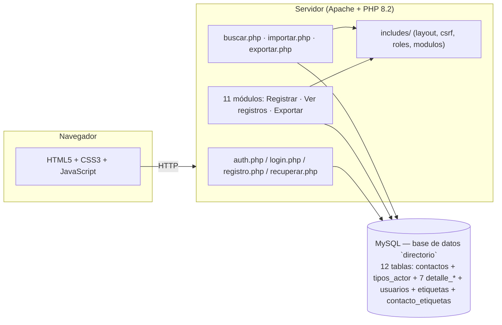

# SIRAD — Sistema de Registro y Administración de Directorios

Aplicación web para centralizar el directorio institucional de la **Fundación Rafael Pombo**: once módulos (instituciones educativas, practicantes, artistas, talleristas, editoriales, asocajas, mercadeo, proveedores, medios, team y directivos), con registro, edición, consulta, eliminación, búsqueda global, importación masiva y exportación a Excel.

Proyecto de grado (Ingeniería de Sistemas, UNIMINUTO). Uso restringido al contexto académico y de la Fundación — no tiene licencia de código abierto.

## Funcionalidades

- **Autenticación**: registro e inicio de sesión con contraseñas encriptadas (`password_hash`), bloqueo temporal tras 5 intentos fallidos, y recuperación de contraseña por un enlace de un solo uso enviado al correo (o, sin servidor de correo, por pregunta de seguridad).
- **Registro con aprobación**: el registro es una *solicitud*. Las cuentas nuevas quedan **pendientes** y no pueden iniciar sesión hasta que un administrador las apruebe en `usuarios.php` (o las rechace). El primer usuario registrado queda como administrador y aprobado. Si el administrador revoca una cuenta, su sesión abierta se cierra en la siguiente petición.
- **Política de tratamiento de datos** (`politica.php`): para crear la cuenta hay que aceptarla; se guardan la versión y la fecha de aceptación (`politica_version`, `politica_aceptada_en`). La versión vigente está en `includes/politica.php`. El texto es un borrador que la Fundación debe revisar y completar con sus datos de contacto.
- **Roles y permisos por módulo**: el primer usuario registrado queda como **administrador** automáticamente; el resto se crea como **usuario**. Editar, eliminar y exportar a Excel están restringidos a administradores. Un usuario aprobado **no ve ni registra nada** hasta que un administrador le asigne, en `usuario_editar.php`, los permisos de cada módulo (se guardan en `usuarios.permisos_modulos`): **Ver** (consultar los registros) y **Registrar** (agregar registros nuevos). Sin permisos, el panel no muestra módulos y se bloquean la búsqueda, la importación y las plantillas; los cambios de permisos rigen de inmediato, incluso en sesiones abiertas.
- **Alertas para el administrador** (`alertas.php`): el encabezado muestra cuántas alertas hay sin leer. Se avisa de las cuentas nuevas (con botones Aprobar y Rechazar), de los inicios de sesión de usuarios y de los intentos de entrar con una cuenta aún no aprobada. No hay una tabla de alertas: se calculan desde `usuarios` (`creado_en`, `ultimo_acceso`, `ultimo_intento_pendiente`) y cada administrador tiene su marca de lectura (`alertas_vistas_hasta`); se muestra el último evento de cada usuario.
- **CRUD por módulo**: cada uno de los once módulos tiene su propio formulario de registro/edición y su vista de consulta, con búsqueda y paginación del lado del cliente.
- **Búsqueda global** (`buscar.php`): busca un término en los once módulos a la vez.
- **Importación masiva** (`importar.php`): carga registros desde un libro de Excel (.xlsx) o un CSV (cualquier separador: coma, punto y coma o tabulador; UTF-8 o Windows-1252), con un máximo de 5 MB y 5.000 filas por archivo (`IMPORTAR_MAX_MB`, `IMPORTAR_MAX_FILAS`; si lo supera no se importa nada) y con una plantilla de Excel descargable por módulo (una columna por campo, celdas de texto) y detección de duplicados (correo, NIT o cédula). La pueden usar los administradores y los usuarios a quienes un administrador les asigne el permiso de importación (columna `puede_importar`, desde `usuarios.php` o `usuario_editar.php`); además, un usuario solo importa a los módulos donde tiene permiso de **Registrar**.
- **Agenda de disponibilidad** (Artistas y Talleristas): cada registro puede tener varios horarios con día, hora de inicio y fin, tipo (disponible u ocupado) y nota. Se guardan en la columna `disponibilidad` (JSON) de la propia fila, con el mismo formato en ambos módulos, de modo que no hay una tabla aparte y la agenda se elimina junto con el registro. Los horarios de un mismo día no pueden cruzarse. El campo de texto `agenda` de Artistas se conserva como «Agenda (notas)».
- **Exportación a Excel** (`exportar.php`): descarga los registros de un módulo filtrados por rango de fechas.
- **Etiquetas** (`etiquetas.php`): quien tiene permiso de **Registrar** en un módulo clasifica sus registros con etiquetas de color; crear y eliminar etiquetas del catálogo es exclusivo del administrador.
- **Reportes** (`reportes.php`): panel solo para administradores con gráficas de barras (registros por módulo, altas por mes, usuarios por rol y etiquetas más usadas).
- **Administración de usuarios** (`usuarios.php`, `usuario_editar.php`): el administrador aprueba, rechaza o revoca cuentas, asigna el permiso de importación, edita nombre, correo y rol, desbloquea cuentas, restablece contraseñas y elimina usuarios, con salvaguardas que impiden quitar el rol o el acceso al único administrador y cambiar el estado de la propia cuenta.
- **Auditoría**: cada registro guarda quién lo creó y quién lo modificó por última vez (`creado_por`, `actualizado_por`, `actualizado_en`).
- **Manual de uso dentro del sistema**: un botón «Manual» fijo en la esquina inferior derecha de todas las pantallas (con un botón verde de WhatsApp al lado que abre el chat con el administrador, `CONTACTO_WHATSAPP`) abre un panel con el manual (`includes/ayuda.php`, `js/ayuda.js`): se abre en la sección de la pantalla actual, tiene buscador, se cierra con Esc y muestra solo las secciones que corresponden al rol de quien lo mira. Se puede apagar con `AYUDA_ACTIVA = false`.
- **Solicitudes de cuenta**: el formulario pide un motivo (15 a 500 caracteres) que el administrador ve junto a la solicitud (panel de usuarios, edición y alertas); se limitan a 3 por conexión cada 60 minutos y a 30 pendientes en total, y los avisos de límite, de rechazo y de cuenta eliminada (también si la sesión estaba abierta) indican que debe comunicarse con el administrador por WhatsApp, con enlace directo. Se ajustan con `SOLICITUDES_MAX_POR_IP`, `SOLICITUDES_VENTANA_MIN`, `SOLICITUDES_MAX_PENDIENTES`, `CONTACTO_WHATSAPP`, `CONTACTO_CORREO` y `CONTACTO_TELEFONO` (en `config.php` o `config.local.php`; sin WhatsApp ni correo configurados se usa el correo del administrador más antiguo).
- **Sin duplicados**: en cada módulo no se repite el correo, ni el NIT (Instituciones Educativas y Editoriales) ni la cédula (Directivos); la regla está en la base de datos (llaves `UNIQUE`) y la aplicación avisa con un mensaje claro, también al editar y al importar.
- **Contraseñas seguras**: toda contraseña nueva (registro, recuperación y restablecimiento por un administrador) debe tener de 8 a 64 caracteres con mayúscula, minúscula, número y símbolo, no ser una clave común ni contener el usuario del correo (`includes/password.php`); las pantallas muestran los requisitos y un medidor de nivel (`js/password.js`). Las contraseñas ya guardadas no se modifican.
- **Listas paginadas**: cada módulo muestra 50 registros por página con búsqueda en el servidor, para que siga rápido con decenas de miles de registros.
- **Seguridad**: sentencias preparadas (mysqli) en toda consulta con datos de usuario, salida escapada con `htmlspecialchars`, tokens CSRF en los formularios POST, y una lista blanca de módulos/tablas para exportar, buscar e importar. Además (ver «Seguridad y despliegue»): archivos internos protegidos por `.htaccess`, sesión y cabeceras seguras, límite de intentos al recuperar la contraseña y exportación a Excel sin inyección de fórmulas.
- **Avisos que desaparecen solos**: los mensajes de las pantallas de acceso (solicitud enviada, cuenta pendiente o rechazada, errores) y los avisos del administrador (cuenta aprobada o rechazada) se quitan pasados unos segundos (`js/mensajes.js`, `js/toast.js`).

## Arquitectura



## Stack

- **Backend**: PHP 8.2 (mysqli, sentencias preparadas)
- **Base de datos**: MySQL / MariaDB (esquema versionado en [`db/schema.sql`](db/schema.sql))
- **Frontend**: HTML5, CSS3 (sin frameworks), JavaScript con la Web Animations API
- **Entorno local**: XAMPP (Apache + PHP + MySQL)

## Estructura del proyecto

```
proyecto/
├── includes/          # contactos.php (acceso a los datos de los módulos), ayuda.php, contacto.php, layout.php, csrf.php, roles.php, modulos.php, paginacion.php, duplicados.php, correo.php, password.php, xlsx.php, importacion.php (compartidos)
├── css/, js/           # estilos y animaciones
├── db/                 # schema.sql y backup.php (respaldo por CLI)
├── docs/               # diagrama entidad-relación (PNG y .drawio editable)
├── {modulo}.php             # Registrar / editar
├── {modulo}_registros.php   # Ver registros
├── {modulo}_exportar.php    # Descargar Excel (solo admin)
├── login.php, registro.php, recuperar.php, restablecer.php, logout.php
├── buscar.php, importar.php, exportar.php
└── index.php            # Panel principal
```

## Instalación local (XAMPP)

1. Copia la carpeta del proyecto a `C:\xampp\htdocs\`.
2. Crea la base de datos e importa el esquema:
   ```bash
   mysql -u root < db/schema.sql
   ```
   > **Atención:** `schema.sql` ejecuta `DROP TABLE IF EXISTS` sobre cada tabla de la base `directorio`. Si ya tienes datos allí, haz primero un respaldo (`php db/backup.php`).
3. Revisa las credenciales en [`config.php`](config.php) (por defecto: `root` sin contraseña, como en una instalación XAMPP estándar).
4. Inicia Apache y MySQL desde el panel de XAMPP.
5. Abre `http://localhost/proyecto/registro.php` y crea la primera cuenta — quedará como administrador automáticamente. Las cuentas siguientes quedan pendientes hasta que el administrador las apruebe en `usuarios.php`.

### Actualizar una base existente

Si ya tienes la base `directorio` con datos, no vuelvas a importar `schema.sql`: haz un respaldo (`php db/backup.php`) y aplica las migraciones que falten, en orden de fecha. Ninguna borra datos. Hasta la de motivo y límite de solicitudes dejan la base en 14 tablas (una por módulo); la última la convierte al modelo generalizado de 12 tablas:

```bash
# Desde la versión 1.0 (esquema original):
mysql -u root directorio < db/migraciones/2026-11-11_actualizacion_version_2.sql
# Desde la base con 17 tablas (disponibilidad, permisos y alertas), que se convierten en columnas:
mysql -u root directorio < db/migraciones/2026-11-11_consolidar_desde_17_tablas.sql
# Siempre, para la prevención de duplicados y la recuperación por correo (en este orden de fecha; la última agrega el motivo y la dirección de las solicitudes):
mysql -u root directorio < db/migraciones/2026-11-12_unicidad.sql
mysql -u root directorio < db/migraciones/2026-11-12_recuperacion_por_correo.sql
mysql -u root directorio < db/migraciones/2026-11-13_motivo_y_limite_solicitudes.sql
# Modelo generalizado (contactos + tipos_actor + detalle_*): conserva los datos de los once módulos, la agenda y las etiquetas
mysql -u root directorio < db/migraciones/2026-11-14_modelo_generalizado.sql
# Marca como aceptada la política de datos en las cuentas creadas antes de que existiera (no cambia la estructura)
mysql -u root directorio < db/migraciones/2026-11-15_politica_cuentas_anteriores.sql
```

Si ya hay correos, NIT o cédulas repetidos, `2026-11-12_unicidad.sql` falla con «Duplicate entry»: el propio archivo explica cómo encontrar los repetidos para depurarlos y volver a ejecutarlo.

Las cuentas existentes quedan aprobadas (sin permisos por módulo hasta que un administrador se los asigne).

## Modelo de datos

La base `directorio` usa un **modelo generalizado** de 12 tablas y 12 llaves foráneas (`db/schema.sql`):

- `contactos` guarda los datos comunes de los once actores del directorio (nombre, apellido, cargo, organización, NIT, correo, teléfonos, dirección, ciudad, departamento, país, perfil, contacto, disponibilidad y la auditoría `fecha_registro`, `creado_por`, `actualizado_en`, `actualizado_por`). `tipos_actor` indica de cuál se trata.
- Cada tipo con datos propios tiene una tabla `detalle_*` (relación 1 a 0..1: su llave primaria `id_contacto` es a la vez llave foránea de `contactos`): `detalle_directivo`, `detalle_institucion`, `detalle_personal` (la comparten Practicantes y Equipo, distinguidos por `vinculacion`), `detalle_mercadeo`, `detalle_medio`, `detalle_artista` y `detalle_editorial`. Talleristas, Proveedores y Asocajas no necesitan detalle.
- `etiquetas` y `contacto_etiquetas` (llave compuesta `id_contacto` + `id_etiqueta`, ambas con `ON DELETE CASCADE`).
- `usuarios` (`id_usuario`) conserva las columnas de la aprobación de cuentas, permisos por módulo, alertas, recuperación de contraseña y solicitud (`estado`, `permisos_modulos`, `reset_token_hash`, `motivo_solicitud`...).

Relaciones: `contactos.id_tipo_actor` → `tipos_actor` (`ON DELETE NO ACTION`: no se borra un tipo con contactos); `contactos.creado_por` y `actualizado_por` → `usuarios.id_usuario` (`ON DELETE SET NULL`: al borrar un usuario se conserva el registro y solo se anula su autor); cada `detalle_*` y `contacto_etiquetas.id_contacto` → `contactos` (`ON DELETE CASCADE`).

Llaves únicas, que impiden registros repetidos dentro de un módulo: `contactos (id_tipo_actor, correo)`, `contactos (id_tipo_actor, nit)` y `detalle_directivo (cedula)`. El código accede a los datos con `includes/contactos.php`, que arma las consultas a partir de la lista de módulos (`includes/modulos.php`): los formularios y las pantallas usan los nombres de campo de siempre (por ejemplo la «Caja» de Asocajas se guarda como `contactos.nombre`).


*Figura. Modelo generalizado de la base de datos. La base implementada agrega a `contactos` las columnas `contacto` y `disponibilidad` y conserva en `usuarios` las columnas de aprobación, permisos, alertas y recuperación, que la figura no detalla.*

El diagrama editable está en [`docs/diagrama_er.drawio`](docs/diagrama_er.drawio) (se abre en diagrams.net o se importa en Lucidchart).

## Respaldo de la base de datos

```bash
php db/backup.php
```

Genera un `.sql` con estructura y datos en `db/backups/`. La carpeta `db/` está bloqueada por HTTP mediante `.htaccess` (ver «Seguridad y despliegue»); el script solo se ejecuta por línea de comandos.

## Seguridad y despliegue

- **Archivos internos**: `.htaccess` (en la raíz, `db/`, `logs/` e `includes/`) impide descargar por HTTP el repositorio `.git`, los respaldos y el esquema (`db/`), los registros de errores (`logs/`), los archivos compartidos (`includes/`), la configuración (`config.php`, `conexion.php`, `auth.php`) y los archivos `*.sql`, `*.log` y `*.md`, y desactiva el listado de carpetas. Requiere que Apache tenga `AllowOverride All` en la carpeta del proyecto y `mod_rewrite` (XAMPP los trae). **Verifique después de instalar** que `http://localhost/proyecto/db/schema.sql` y `http://localhost/proyecto/.git/HEAD` no se descargan. Si se publica en otro servidor, mueva `db/`, `logs/` e `includes/` fuera de la carpeta pública.
- **Sesión**: `includes/sesion.php` configura la cookie (HttpOnly, SameSite=Lax y Secure bajo HTTPS), rechaza identificadores de sesión no emitidos por el servidor, renueva el identificador al iniciar sesión y vacía la sesión y la cookie al cerrarla. Las páginas autenticadas se envían sin caché.
- **Cabeceras**: `X-Frame-Options`, `X-Content-Type-Options`, `Referrer-Policy`, `Permissions-Policy` y `Content-Security-Policy` (permite scripts y estilos en línea porque las páginas los usan).
- **Recuperar contraseña por correo**: el usuario recibe un enlace con un token aleatorio de 256 bits (en la base solo se guarda su hash SHA-256) que vence a los 30 minutos y sirve una sola vez; la respuesta es la misma exista o no la cuenta, no se reenvía antes de 2 minutos y solo se envía a cuentas aprobadas. Para activarlo, copie las constantes de correo de `config.php` a un archivo `config.local.php` (no se sube al repositorio) con `MAIL_MODO = 'smtp'`, `MAIL_HOST`, `MAIL_PUERTO`, `MAIL_SEGURIDAD` (`tls`, `ssl` o `ninguna`), `MAIL_USUARIO`, `MAIL_CLAVE`, `MAIL_REMITENTE` y `APP_URL` (la dirección pública, con la que se arma el enlace). Con `MAIL_MODO = 'archivo'` los mensajes se guardan en `logs/correos/` (desarrollo). Si `RECUPERAR_POR_CORREO` es falso (valor por defecto sin SMTP) se usa la pregunta de seguridad: cada respuesta incorrecta suma un intento fallido de la cuenta; a los 5 la cuenta se bloquea 15 minutos (el mismo bloqueo del inicio de sesión). Un administrador puede desbloquearla.
- **Exportación a Excel**: las celdas se marcan como texto, de modo que un dato que empiece por `=`, `+`, `-` o `@` no se ejecuta como fórmula.
- **Peticiones anómalas**: los parámetros que llegan como arreglo (`q[]=x`) donde se espera texto se rechazan con 400 (`includes/sesion.php`); `.htaccess` solo admite GET, POST y HEAD y bloquea la copia anidada `proyecto-tesis/`.
- **Pendiente para producción**: servir por HTTPS, desactivar TRACE (`TraceEnable Off`) y ocultar la versión de Apache y PHP (`ServerTokens Prod`) en `httpd.conf`, definir una contraseña para el usuario `root` de MySQL y usar una cuenta de base de datos con privilegios mínimos.
